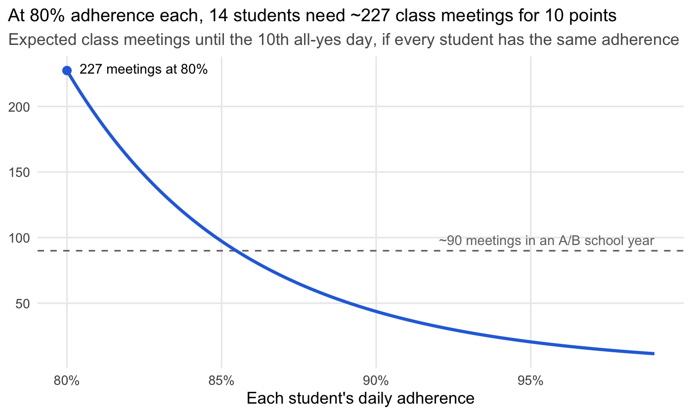
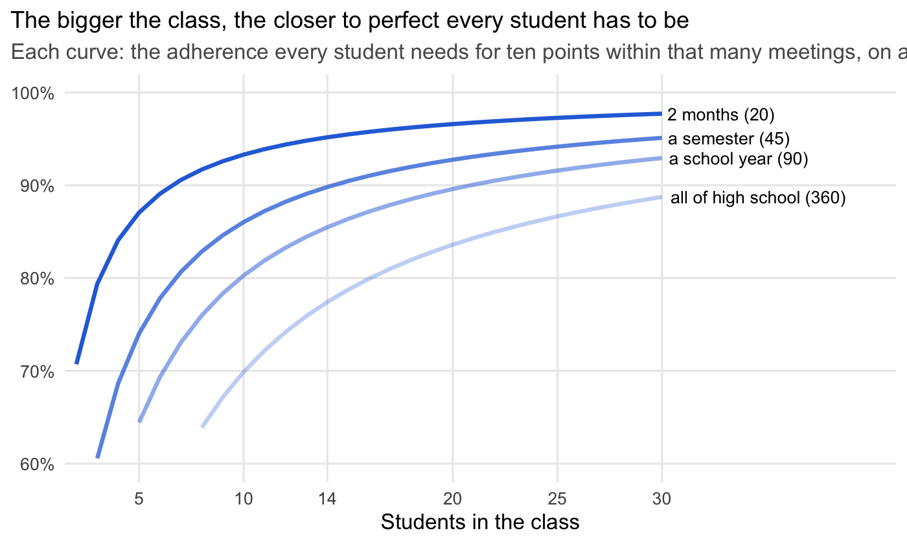
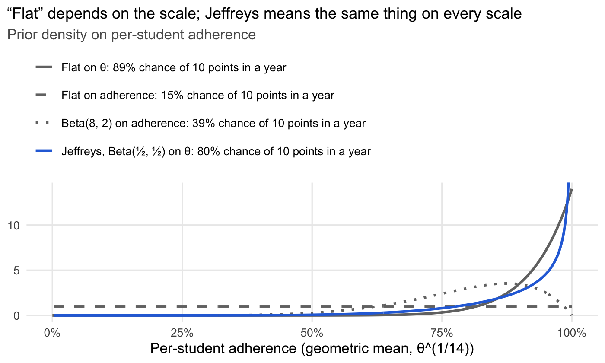
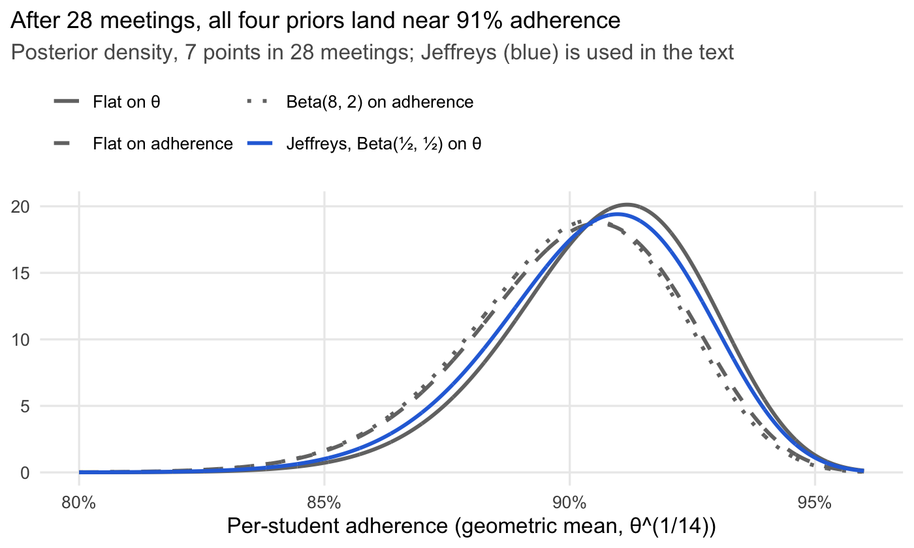
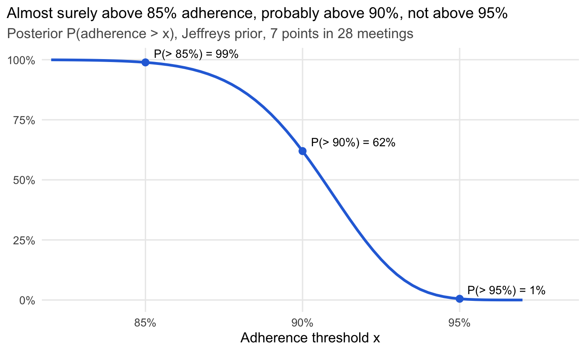
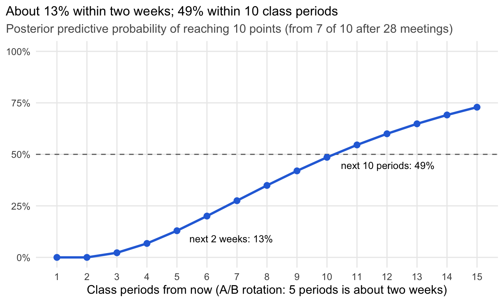

My oldest son is taking high school band this year. His class is about half neurodivergent ("neurospicy," as the kids say) and medicated. To encourage medication adherence, the band director introduced a game: if every student confirms they took their medication that morning, the class earns a point. At ten points, the director buys McDonald's for everyone the next class, and they eat and "chill" instead of having regular class.

## Making it better: spin the wheel

My first thought was that this is a clever positive-reinforcement setup. Of the four operant-conditioning quadrants (positive and negative reinforcement, positive and negative punishment), positive reinforcement is the one generally favored, both for results and for goodwill between trainer and trainee.

But you can generally make training even more effective with *variable* reinforcement. Remember Skinner's variable-ratio schedules? Rewards that arrive after an unpredictable number of responses produce high, steady response rates that are slow to extinguish. It's the same mechanic behind the pull of slot machines.

Here's my improvement idea: have an LLM build a little web app you can project in class. Whenever the class would have earned a point under the current system, you instead "spin the wheel" with a 1-in-10 chance of winning the meal for the next class period. On average the director buys one meal per ten points either way, but the kids get immediate reinforcement, and excitement, every single class period -- or at least when everyone did take their meds. Fun!

For the director, there is a small price to pay: variance. Under the fixed schedule, a meal comes after exactly 10 points. Under the wheel, the number of points until a meal is geometric with mean 10 but standard deviation of about 9.5. The class could win twice in one week, or go 20 points without a meal (probability $0.9^{20} \approx 12\%$). There's a catch in the director's favor, though: the game resets every school year. Under the current rules, a class that earns nine points in a year gets nothing. Under the wheel, it expects almost a meal. So with a yearly reset, the wheel pays out more often, not the same as the current rules.

## One student: a negative binomial

Let's break this down into a simpler experiment first. Pretend it's just you, playing a game to motivate yourself to take your medication.

Medication adherence is rarely 100%. Clinical trials commonly count a patient as adherent if they take at least 80% of their doses, so let's start there: you take your medication exactly 80% of days. Each day is then a Bernoulli trial with success probability $p = 0.8$. Counting days until you collect 10 successes gives a negative binomial distribution.

One wrinkle: there are two common ways to write a negative binomial. We'll count the missed days $F$ before the $r$-th success, which is how R's `dnbinom`, SciPy's `nbinom`, SAS's `negbin` and the model below all define it. The total number of days is then $T = r + F$.

With $r = 10$ and $p = 0.8$, you expect $E[F] = r(1 - p)/p = 2.5$ missed days, so the reward takes $E[T] = r/p = 12.5$ days on average, about two and a half school weeks.

## The class: a nested problem

That was pretty straightforward. Now back to the class. Instead of one student, 14 are playing. Each has some chance of missing a dose, and the class earns a point only on days when all 14 say yes. Each class day is still a Bernoulli trial, but its success probability $\theta$ is the *product* of 14 individual adherences. Treat those adherences as draws from a population distribution and you have a simple hierarchical model.

$$
\begin{aligned}
p_i &\sim \operatorname{Beta}(\alpha, \beta), && i = 1, \dots, 14 && \text{each student's adherence} \\
\theta &= \prod_{i=1}^{14} p_i && && \text{chance all 14 say yes} \\
y \mid \theta &\sim \operatorname{NegBin}(r = 10,\ \theta) && && \text{meetings without a point before the 10th}
\end{aligned}
$$

Here $y = D - 10$, where $D$ is the meeting on which the tenth point lands. The middle line is where the story lives: on each meeting, student $i$ takes their meds with probability $p_i$, and the class earns a point only if all 14 do. If students and days are independent given the $p_i$, each meeting is a Bernoulli($\theta$) trial, and the failures before the tenth success are negative binomial.

Two things fall out. First, the data identify only $\theta$ - one number (points earned in so many meetings) can't separate 14 individual adherences, or $\alpha$ from $\beta$, without a prior. Second, the product is brutal. If every student hits the clinical-trial bar of 80%, $\theta = 0.8^{14} \approx 0.044$, and the class should expect about 227 class meetings to reach ten points (SD $\approx$ 70). With band meeting every other day, that's about two and a half school years. And the game resets each year. Cheap game for the band director if students can't beat that rate!

Class size makes it worse. Turning the formula around, a class of $N$ students expects ten points within $T$ meetings only if each student's adherence is at least $(10 / T)^{1/N}$. A class of 14 needs about 85% to win within a school year, and a class of 30 needs about 93%.

Two things pull $\theta$ away from "average adherence to the 14th power," and they pull in opposite directions. First, take one real classroom with fixed $p_i$. By the AM--GM inequality, $\theta = p_1 \times \cdots \times p_{14} \le \bar p^{14}$, where $\bar p$ is the class's ordinary average. At the same average, a spread-out class earns fewer points than a uniform one, because the least adherent student sets the pace for everyone. Second, and more important, the product itself rests on independence. If students' misses are positively correlated (a shared Monday, the morning after a break), all-yes days come more often than the product predicts. In the extreme, where everyone misses on the same days, $\theta = \min p_i$. So the independence assumption carries most of the weight: correlation pushes $\theta$ above $\prod p_i$, which makes $\theta^{1/14}$ an upper bound on the class's geometric-mean adherence rather than an estimate of it.

## A model the data can fit

Well, that was fun but a little demotivating. They might never earn their treat! But we can run the model in reverse and see how this particular class is doing, which is more interesting. From how many meetings it has taken my son's class to earn its points, we can estimate the class's adherence, then predict when they'll finish. It's an estimate of a class-level summary, not of any particular student, and that's important to keep in mind.

**Counting opportunities.** Utah requires schools to provide educational services on at least 180 days each school year ([Utah Admin. Code R277-419-4](https://www.law.cornell.edu/regulations/utah/Utah-Admin-Code-R277-419-4)). Band runs on an A/B rotation, meeting every other school day, so a school year holds about 90 chances to earn a point before the game resets. So far the class has used 28 of them and earned 7 points.

Since only $\theta$ is identified, the model we can actually fit drops the student level. We put the prior on $\theta$ itself, using the Jeffreys prior, Beta(½, ½). Per-student adherence comes along as a derived quantity: $\bar p = \theta^{1/14}$ is the class's geometric-mean adherence, the one per-student number the data can speak to.

$$
\begin{aligned}
\theta &\sim \operatorname{Beta}(\tfrac12, \tfrac12) && \text{Jeffreys prior} \\
k \mid \theta &\sim \operatorname{Binomial}(n,\ \theta) && k = 7 \text{ points in } n = 28 \text{ meetings} \\
\bar p &= \theta^{1/14} && \text{geometric-mean adherence (derived)}
\end{aligned}
$$

The Beta prior is conjugate, so the posterior is Beta(7.5, 21.5) in closed form, and $\bar p$ is just a transformation of its quantiles. For comparison, the maximum likelihood estimate is $\hat\theta = 7/28 = 0.25$, so $\hat p = 0.25^{1/14} = 0.906$. Note that it doesn't matter that I'm checking in mid-game. Whether you count a fixed number of meetings (binomial) or stop at the tenth point (negative binomial), the likelihood kernel is the same, $\theta^k (1 - \theta)^{n - k}$, and for a Bayesian that's all the data have to say.

The choice of prior deserves more than a sentence. It's tempting to reach for a "flat" prior so the analysis looks "objective," but what is "flat" depends on which scale you're on. Through $\theta = \bar p^{14}$, a flat prior on one scale makes a strong claim on the other. A flat prior on $\bar p$ becomes $\theta \sim \operatorname{Beta}(1/14, 1)$, which puts half its weight below $\theta = 0.00006$. The Jeffreys prior sidesteps this: it's built from the Fisher information, so it means the same thing on every scale. Jeffreys on $\theta$, transformed, is exactly Jeffreys on $\bar p$. That doesn't make it uninformative, though. On the adherence scale it leans optimistic, with only a 13% chance that $\bar p$ is below 80%. So the useful test of any prior is still whether it predicts sensible data. That's where prior predictive simulations come in handy.

Here are three alternatives to compare against Jeffreys (which, somewhat unrealistically, puts the chance of ten points in a year at 80%), each judged by what it predicts *before* we see any data:

- **Flat on θ.** A Uniform(0, 1) prior on the chance that all 14 kids say yes on a given day. It sounds neutral, but on the per-student scale it's wildly optimistic: 96% of its weight sits above 80% adherence. It's 89% sure the class earns ten points within a school year of about 90 meetings.
- **Flat on adherence.** Now 10% adherence is as believable as 90%. This also sounds neutral, and it's still conjugate: $\theta \sim \operatorname{Beta}(1/14, 1)$. But half its weight sits below 50% adherence, where an all-yes day comes about once every 16,000 school days. It gives the class only a 15% chance of ten points in a year. It believes the game is mostly unwinnable.
- **Weakly informative.** A Beta(8, 2) on adherence, centered on the 80% clinical-trial benchmark, with 95% of its weight between 52% and 97%. It rules out the silly worlds without pretending to know the answer, and it gives the class a 39% chance of ten points in a year. It isn't conjugate in θ, but a grid over one parameter takes a few lines of code. This is closer to what I'd use in a "real" problem.

This is the point Gelman and McElreath keep making: a prior is a claim about what data you expect to see. The way to check it is to simulate data from it, a *prior predictive check*. "Uninformative" priors often make confident, silly predictions on a scale you weren't looking at.

The good news: 28 meetings of data swamps all four, so we don't have to worry too much about it for purposes of this blog post, and the prior matters more for honesty than for the answer.

The Jeffreys prior gives a posterior median of 90.6% and a 95% interval of 85.9%--94.1%. The other three land within about 0.5 percentage points of it.

The posterior also answers "how sure are we that the class beats X?" directly:

## How much longer?

Three points to go. Given $\theta$, the number of further meetings until the tenth point is negative binomial with $r = 3$. Averaging over the Beta(7.5, 21.5) posterior gives a beta-negative-binomial, again in closed form: about 13 more class periods on average, with a median of 11. That's about a 13% chance within the next 5 class periods (roughly two weeks) and 49% within the next 10.

My son was hoping they'd finish this week, but 3 more points need at least 3 more class periods. The forecast also assumes $\theta$ holds steady; a meeting right after a long break may be a rough one.

## Caveats

The 91% estimate holds only as well as the model's assumptions, and several of them are shaky:

- **Self-report.** Every answer is a kid saying "yes," and the whole class wants McDonald's. Any fibbing biases $\hat\theta$ upward.
- **Independence.** Students' misses aren't independent. The meds are taken at home, but students share a school calendar. Early starts, Mondays, the morning after a break, and testing days disrupt everyone's routine on the same day. Positive correlation makes all-yes days more common than a product of marginals predicts.
- **Constant adherence.** Fridays, Mondays, and the days after a break probably differ from midweek.
- **Group contingency.** One student's miss costs everyone a point, and confirming medication in front of peers isn't private. Both are worth weighing alongside the cleverness. This also goes back to the self-report issue. Especially if the class is at 9 points, I know I wouldn't want to be the kid single handedly causing another point miss.

## How does this compare with real-world data?

Next to real-world data on teenagers, the class's roughly 91% looks quite high, though the published numbers measure something different.

| Study | Population | Adherence measure | Result |
|------------------|------------------|------------------|------------------|
| [Ferrin et al. 2024](https://iris.unica.it/bitstream/11584/430266/1/Ferrin%202024%20accepted.pdf), systematic review, *European Child & Adolescent Psychiatry* | Under 18 with ADHD; 66 studies | Medication possession ratio ≥ 80% at 12 months | 22.9% of patients (pooled from 3 studies) |
| [Kaiser Permanente cohort](https://divisionofresearch.kaiserpermanente.org/teens-who-stop-taking-adhd-medication/), *Journal of Adolescent Health*, 2021 | 4,466 17-year-olds with ADHD | Fills covering ≥ 70% of prescribed days | 25.6% at 18 and 19% at 19, down from 36.7% at 17 |
| [Swedish national register, 2015--2020](https://synapsesocial.com/papers/W7125252264) | 128,366 patients on oral stimulants | Proportion of days covered ≥ 80% | 49.7--52.4% of 12--17-year-olds, vs. 69.3--71.8% of adults 25 and older |

These are apples and oranges in three ways:

- **Different quantity.** The studies report the share of patients who clear a threshold. We estimated a daily rate. A class where everyone takes their meds 91% of days would have 100% of students above an 80% bar.
- **Different measurement.** Pharmacy refills can't see pills that are filled but not swallowed. Self-report can't see a kid saying yes to protect the McDonald's run.
- **Different population.** Registries include kids who quit their medication entirely. Every kid in this game is, by definition, still on it.

So the gap could mean the game works, these kids are an already-adherent group, or some yeses are fibbed. The data can't tell those apart.

### What if the game changed nothing?

Suppose these 14 kids adhered like the teenagers in the published studies. Would the director ever buy McDonald's? Almost never. The game resets every school year, so the class gets about 90 meetings to reach ten points, and then starts over at zero. On real-world adherence, the class would have about a 2% chance of a meal in a given year, and under 10% across all four years of high school.

To get there, I turned each study's "share of teens above the bar" into a distribution of daily adherence: a Beta with a concentration of $a + b = 10$, with its mean set so the right share of kids clears the study's threshold. I then simulated 2e+05 classes of 14 drawn from it, and counted meetings to ten all-yes days at about 90 meetings a year.

| Benchmark | Implied average adherence | Chance of a meal in a given school year | Chance of any meal in 4 years |
|:-------------------|:--------------|:---------------------|:----------------|
| Swedish register: 51% of teens ≥ 80% | 78% | 2.3% | 9.0% |
| Ferrin review: 23% ≥ 80% | 69% | under 0.01% | under 0.01% |
| Kaiser cohort: 37% ≥ 70% | 64% | under 0.01% | under 0.01% |

Table 1

The spread is my assumption, but it barely matters here. With a tighter Beta ($a + b = 20$) or a looser one ($a + b = 5$), the chance of a meal in a given year for a Swedish-like class stays between 1.9% and 2.4%. Without the reset, a Swedish-like class would eventually win after a median of 3 to 6 years. With it, those near-misses just evaporate each June.

The product of 14 adherences is merciless. A class that averages 78%, a better-than-typical teenage result, all says yes on about 3% of days. This class is earning points roughly 8 times as often. Either the game is working, these kids were already unusually adherent, or some of the yeses are hopeful. Whatever the reason, the director wrote a bet they should almost never lose, and they're about to lose it. Look at those kids go!
